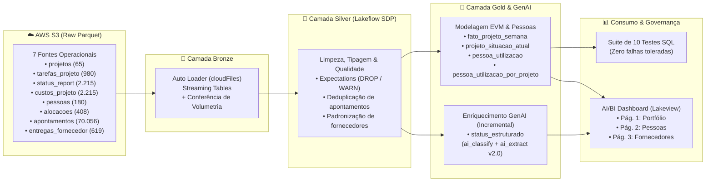
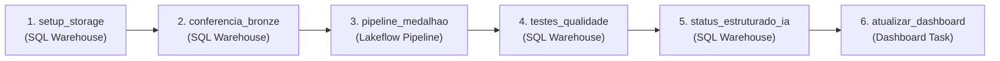

<div align="center">

# 🚨 Projeto Farol · Vértice Consultoria

**Plataforma Lakehouse End-to-End para Governança de Portfólio (EVM), Inteligência de Alocação e Auditoria de Status com IA Generativa no Databricks**

[-FF3621?style=for-the-badge&logo=databricks&logoColor=white)](https://docs.databricks.com/aws/en/dev-tools/bundles)
[](https://docs.databricks.com/aws/en/ldp)
[](https://docs.databricks.com/aws/en/data-governance/unity-catalog)
[](https://docs.databricks.com/aws/en/large-language-models/ai-functions)
[](https://docs.databricks.com/aws/en/dashboards)

</div>

---

## 🎯 Sobre o Projeto

O **Projeto Farol** é uma solução moderna de Engenharia e Análise de Dados construída integralmente sobre a plataforma **Databricks** para resolver um problema clássico de grandes consultorias de tecnologia: a **falta de visibilidade real sobre prazo, custo, alocação de talentos e gargalos operacionais** em dezenas de contratos simultâneos.

Na **Vértice Consultoria** (65 projetos, 180 profissionais e carteira ativa de **R$ 208,6 milhões**), relatórios executivos manuais escondiam desvios graves de cronograma e orçamento. O Projeto Farol automatiza desde a ingestão bruta em nuvem até a recomendação executiva com **IA Generativa** e **Dashboards AI/BI como código**:

- 🍉 **Detecção de "Projetos Melancia"** *(verdes por fora, vermelhos por dentro)*: confronta o semáforo subjetivo reportado pelo gerente (`verde`/`amarelo`/`vermelho`) com o farol matemático calculado via **EVM (Earned Value Management — SPI & CPI)**.
- 👻 **Combate à Alocação Fantasma**: cruza a escala teórica de alocação de consultores com os apontamentos reais em timesheet, revelando capacidade ociosa de profissionais seniores enquanto outros projetos atrasam por falta de braço.
- 🤖 **Estruturação de Status Reports com GenAI**: utiliza funções nativas do Databricks (`ai_classify` e `ai_extract` v2.0) para ler textos livres dos gerentes, classificar a causa raiz de bloqueios, identificar o responsável pelo destrave e estimar os dias de impacto.
- 🤝 **Auditoria de Fornecedores Terceiros**: higieniza grafias divergentes de parceiros e mede a aderência real às estimativas de esforço e prazos de entrega.

---

## 🏗️ Arquitetura da Solução

Todo o projeto segue a **Arquitetura Medalhão (Bronze → Silver → Gold)** governada no **Unity Catalog** (`lakehouse_vertice`), orquestrada por **Lakeflow Jobs** e versionada via **Databricks Asset Bundles (DABs)**.



---

## 🧠 Destaques Técnicos e Regras de Negócio

### 1. Engenharia de Dados Declarativa (`Bronze` & `Silver`)
- **Ingestão Incremental com Auto Loader (`cloudFiles`)**: leitura contínua de arquivos Parquet no S3 com inferência e evolução controlada de schema.
- **Data Quality com Lakeflow Expectations**:
  - Regras críticas com `ON VIOLATION DROP ROW` (ex.: `valor_contrato > 0`, `horas_estimadas > 0`, `custo_hora > 0`, datas válidas).
  - Regras de auditoria com `ON VIOLATION WARN` para monitoramento de anomalias sem perda silenciosa.
- **Deduplicação Determinística**: remoção de **693 apontamentos duplicados** (`70.056 → 69.363` registros válidos) utilizando `ROW_NUMBER() OVER (PARTITION BY id_pessoa, id_projeto, id_tarefa, data ORDER BY _ingested_at DESC)`.
- **Entity Resolution em Fornecedores**: unificação de 4 grafias distintas (`CodeForge`, `CodeForge Ltda`, `Codeforge Consultoria`, `CodeForge Consultoria`) para uma entidade canônica, revelando o maior gargalo terceirizado da consultoria.

### 2. Modelagem Analítica de Portfólio — EVM (`Gold`)
Cálculo semanal da Curva S para cada projeto com base na data de referência da carteira:
- **PV *(Planned Value)***: orçamento ponderado pelas tarefas planejadas até a semana.
- **EV *(Earned Value)***: orçamento ponderado pelas tarefas efetivamente concluídas até a semana.
- **AC *(Actual Cost)***: custo real acumulado até a semana.
- **Indicadores de Performance**:
  $$\text{SPI} = \frac{\text{EV}}{\text{PV}} \qquad \text{CPI} = \frac{\text{EV}}{\text{AC}} \qquad \text{EAC} = \frac{\text{Valor do Contrato}}{\text{CPI}}$$
- **Regra do Efeito Melancia (`is_melancia`)**:
  - `farol_calculado`: **Crítico** (`SPI < 0.85` ou `CPI < 0.85`), **Atenção** (`SPI < 0.95` ou `CPI < 0.95`), ou **Saudável**.
  - Se `farol_calculado IN ('atenção', 'crítico')` e `farol_gerente = 'verde'`, o projeto é marcado automaticamente como **Melancia (`TRUE`)**.

### 3. Inteligência Artificial Generativa no SQL (`Gold + AI Functions`)
Pipeline incremental via `MERGE INTO` que processa exclusivamente os textos de `status_report` dos projetos em andamento nas últimas 8 semanas (~328 registros), economizando tokens e garantindo idempotência:
- **`ai_classify` (v2.0)**: classifica cada relato nas categorias `change_freeze`, `fornecedor_atraso`, `ambiente_acesso`, `escopo_mudanca`, `falta_de_gente`, `aprovacao_cliente` ou `sem_bloqueio`.
- **`ai_extract` (v2.0)**: extrai de forma estruturada o JSON com `bloqueio`, `quem_destrava` e `dias_impacto` (convertendo expressões como *"1 semana"* para `7`).

### 4. Dashboard as Code (`Lakeview AI/BI`)
O arquivo `.lvdash.json` é gerado programaticamente via Python (`scripts/gerar_dashboard.py`), garantindo versionamento em Git, padronização visual (tema escuro `#14141A` com paleta `#0059DB` / `#22C2F4`) e implantação automática pelo DABs em 3 páginas:
1. **Portfólio**: 7 KPIs executivos, matriz completa de projetos com formatação condicional e evolução semanal da curva `SPI` vs. `CPI`.
2. **Pessoas**: ranking Top 15 profissionais com maior capacidade ociosa (`horas_ociosas`) e detalhamento de **alocações fantasma** (`pct_alocado >= 50%` e `< 20%` das horas esperadas realizadas).
3. **Fornecedores**: causas de bloqueio extraídas por IA por projeto, scorecard de parceiros e lista de entregas vencidas.

---

## 📈 Principais Descobertas nos Dados

| Indicador / Diagnóstico | Resultado Apurado | Impacto Executivo |
| :--- | :---: | :--- |
| **Carteira Ativa (`em_andamento`)** | **R$ 208.631.000,00** | 41 projetos ativos monitorados em tempo real |
| **SPI / CPI Consolidados da Carteira** | **0,92 / 0,97** | Descolamento de prazo a partir de ago/2026 |
| **Estouro Total Previsto (`EAC - Contrato`)** | **R$ 6.465.127,22** | Concentrado nos projetos críticos da carteira |
| **Projetos em Risco (`atenção` + `crítico`)** | **17 projetos** | Sendo **7 críticos** que exigem intervenção imediata |
| **Projetos Melancia (`is_melancia = TRUE`)** | **4 projetos** | Reportados como `verde` pelo gerente, mas em atraso/estouro real |
| **Alocações Fantasma Detectadas** | **57 alocações** | Profissionais seniores/plenos "presos no papel" sem apontar horas |
| **Fornecedor Crítico (`CodeForge Consultoria`)** | **0,0% no prazo** | 349 entregas, razão horas reais/estimadas de **1,41x** e 5 entregas vencidas |

---

## 📂 Estrutura do Repositório

```text
verticeaovivo/
├── databricks.yml                        # Configuração principal do Databricks Asset Bundle
├── resources/
│   ├── vertice_medalhao.pipeline.yml     # Definição do Lakeflow Declarative Pipeline (Bronze/Silver/Gold)
│   ├── vertice.job.yml                   # Job orquestrador com 6 tasks em sequência (Segundas às 06h)
│   ├── dashboard.dashboard.yml           # Recurso DABs do Dashboard AI/BI
│   └── dashboard-portfolio.lvdash.json   # Especificação JSON do Lakeview Dashboard (3 páginas)
├── scripts/
│   └── gerar_dashboard.py                # Gerador programático do arquivo .lvdash.json
├── src/
│   ├── ingestao/
│   │   ├── 01-setup-storage.sql          # External Location e catálogos no Unity Catalog
│   │   └── 02-ingestao-bronze.sql        # Streaming Tables via Auto Loader (cloudFiles)
│   ├── conferencia/
│   │   └── 00-conferencia-bronze.sql     # Validação de volumetria das 7 tabelas Bronze
│   ├── silver/
│   │   ├── 01-projetos.sql               # Higienização e expectations de projetos
│   │   ├── 02-tarefas.sql                # Tarefas com cálculo de atraso em dias
│   │   ├── 03-status-e-custos.sql        # Status reports e custos semanais
│   │   ├── 04-pessoas.sql                # Pessoas, alocações e deduplicação de apontamentos
│   │   └── 05-fornecedores.sql           # Unificação de grafias e métricas de fornecedores
│   ├── gold/
│   │   ├── 01-fato-projeto-semana.sql    # Curva S semanal e indicadores EVM (PV, EV, AC, SPI, CPI)
│   │   └── 02-situacao-e-pessoas.sql     # Snapshot atual, efeito melancia e utilização de pessoas
│   ├── ia/
│   │   └── status_estruturado.sql        # Classificação e extração incremental com AI Functions v2.0
│   └── testes/
│       └── testes.sql                    # 10 asserções automatizadas de qualidade de dados
└── LLM/                                  # Roteiros de engenharia de prompt e especificações do desafio
```

---

## ⚙️ Orquestração do Pipeline (`vertice_farol`)

O Job principal é agendado para rodar toda **segunda-feira às 06:00 (`America/Sao_Paulo`)** com 6 tasks encadeadas:



---

## 🚀 Como Executar o Projeto

### Pré-requisitos
- [Databricks CLI](https://docs.databricks.com/dev-tools/cli/install.html) (`v0.220+`) configurado e autenticado.
- Python `3.10+` (para geração do artefato do dashboard).
- Um **SQL Warehouse** ativo e permissão no **Unity Catalog**.

### 1. Configurar variáveis locais do ambiente
As credenciais e IDs de infraestrutura ficam isolados localmente em `.databricks/bundle/dev/variable-overrides.json` (ignorado pelo Git):

```json
{
  "warehouse_id": "<SEU_SQL_WAREHOUSE_ID>",
  "catalog": "lakehouse_vertice",
  "s3_access_key": "<SUA_AWS_ACCESS_KEY>",
  "s3_secret_key": "<SUA_AWS_SECRET_KEY>"
}
```

### 2. Gerar o artefato do Dashboard AI/BI
```bash
python scripts/gerar_dashboard.py
```

### 3. Validar, publicar e executar o Bundle
```bash
# Validar a sintaxe e recursos do bundle
databricks bundle validate

# Fazer deploy do Pipeline, Job e Dashboard no Workspace
databricks bundle deploy

# Executar o fluxo completo de ponta a ponta
databricks bundle run vertice_farol

# Exibir os links diretos dos recursos publicados
databricks bundle summary
```

---

## 🧪 Governança e Qualidade de Dados

A task `testes_qualidade` executa [testes.sql](src/testes/testes.sql) após cada atualização da camada Gold, validando **10 regras inegociáveis** (via `ASSERT_TRUE`):
1. Contagem exata de projetos higienizados na Silver (`65`).
2. Contagem exata de profissionais ativos/inativos (`180`).
3. Ausência de duplicatas na chave `(id_pessoa, id_projeto, id_tarefa, data)` em `silver.apontamentos`.
4. Padronização das `5` entidades de fornecedores em `silver.entregas_fornecedor`.
5. Cobertura de 100% dos projetos na `gold.projeto_situacao_atual`.
6. Ausência de `SPI` ou `CPI` negativos.
7. Detecção consistente de projetos melancia (`is_melancia = TRUE`).
8. Cobertura integral de profissionais na `gold.pessoa_utilizacao`.
9. Existência de alocações fantasma auditáveis em `gold.pessoa_utilizacao_por_projeto`.
10. Consistência contábil entre o somatório de `valor_contrato` na Silver e na Gold (`< R$ 1,00`).

---

<div align="center">
  <sub>Desenvolvido com foco em Engenharia de Dados Moderna, Governança no Unity Catalog e IA Aplicada no Databricks.</sub>
</div>
